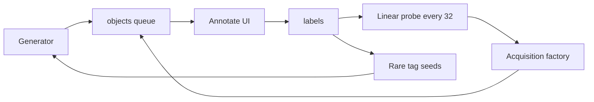

# ExoForge

People explore procedural planets and galaxies, label what they see, and a linear probe on a frozen CLIP encoder updates from those labels. Rare tags bias the next seeds.



## macOS

- Node 22 and pnpm 9 (`corepack enable && corepack prepare pnpm@9.15.9 --activate`).
- Python 3.12 via [uv](https://docs.astral.sh/uv/). Apple Silicon uses PyTorch MPS when torch is installed. No CUDA.

```bash
pnpm install
pnpm --filter @exoforge/web dev
uv venv services/ml/.venv --python 3.12
uv pip install --python services/ml/.venv/bin/python -e "services/ml[dev]"
services/ml/.venv/bin/uvicorn app.main:app --app-dir services/ml --reload
```

Open `/planet/42`, `/galaxy/7`, and `/dashboard`.

## Supabase

Create a project, then put the URL and anon key in `.env.local` (see `.env.example`). Apply [`infra/supabase/migrations/001_init.sql`](infra/supabase/migrations/001_init.sql). Until those values exist, the API uses an in-memory queue so tests and the UI still run.

## Deploy

- Web: Vercel, root `apps/web`, install from the pnpm workspace.
- ML: Hugging Face Space running `uvicorn app.main:app`. Set `ML_SERVICE_URL` on the web app.
- Dataset: `python infra/scripts/export_dataset.py` writes parquet. Upload with the Hugging Face `datasets` library when you have a token. This repo does not push datasets.

## Roadmap

- [x] CLIP ViT-B/32
- [ ] DINOv2-small
- [ ] SigLIP
- [ ] Benchmark write-up in `experiments/encoder_bench.md`

## What you still write by hand

Shader and strategy math is scaffolded on purpose (rules R0–R2, R5).

- `packages/shaders/src/planet/simplex.glsl.ts` — simplex lattice (Inigo Quilez)
- `packages/shaders/src/planet/fbm.glsl.ts` — fBm octaves (Inigo Quilez)
- `packages/shaders/src/planet/ridged.glsl.ts` — ridged fractal and domain warp
- `packages/shaders/src/planet/planet.vert.ts` — height displacement and analytic normals
- `packages/shaders/src/planet/planet.frag.ts` — biome blend (ocean, forest, desert, ice, tundra)
- `packages/shaders/src/planet/atmosphere.glsl.ts` — Rayleigh and Mie ray march (Bruneton)
- `packages/shaders/src/planet/clouds.glsl.ts` — 2–3 volumetric shells
- `packages/shaders/src/planet/water.glsl.ts` — Fresnel and specular
- `packages/shaders/src/planet/night_lights.glsl.ts` — night-side emissive mask
- `packages/shaders/src/galaxy/density.glsl.ts` — Lin & Shu 1964 density wave
- `packages/shaders/src/galaxy/stars.frag.ts` — star color by age
- `packages/shaders/src/galaxy/dust.frag.ts` — dust extinction
- `services/ml/app/acquisition.py` — entropy, BALD (Houlsby 2011), core-set (Sener & Savarese 2018)
- `services/ml/app/encoder.py` — `DINOv2Encoder.embed`
- `experiments/active_learning_bench.md` and `experiments/encoder_bench.md` — measured numbers

The planet you see before that work is a cube-sphere mesh with a latitude tint, a translucent atmosphere shell, and a cloud shell. It is not a finished scattering shader, and it does not claim 60 FPS under a full ray march.

## Success checklist

- Shader FPS on an M1 Air at 1080p: not measured as a finished shader. The mesh path is in place; the metric applies after the manual GLSL.
- +10% F1 over 500 labels: the probe can train, but there is no labeled corpus yet.
- First annotation from a cold open: home links to a planet; the label panel is on that page.
- Open repo and dataset script: this tree plus `infra/scripts/export_dataset.py`.

## References

- Planet LOD: FunSoftWareTechologies/OpenWorlds, ZyFou/ProceduralTerrains
- Atmosphere: binaryfoundry/atmospheric-scattering, Bruneton 2008
- Clouds: dgreenheck/threejs-procedural-planets
- Galaxy particles: sugaith/react-three-fiber-shader-galaxy, N0rvel/galaxy_sim
- Labels: zooniverse/Panoptes
- Galaxy ML: mwalmsley/zoobot, chengsoonong/crowdastro
- Exoplanet citizen science: nikhilsundriya/NebulaX
