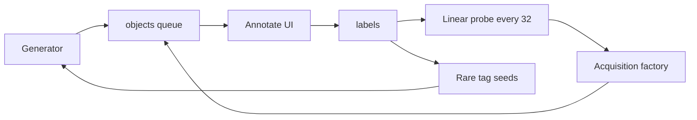

# ExoForge

People explore procedural planets and galaxies, label what they see, and a linear probe on a frozen CLIP encoder updates from those labels. Rare tags bias the next seeds.



## macOS

- Node 22 and pnpm 9 (`corepack enable && corepack prepare pnpm@9.15.9 --activate`).
- Python 3.12 via [uv](https://docs.astral.sh/uv/). Apple Silicon uses PyTorch MPS when torch is installed. No CUDA.

```bash
pnpm install
pnpm --filter @exoforge/web dev
uv venv services/ml/.venv --python 3.12
uv pip install --python services/ml/.venv/bin/python -e "services/ml[dev]"
services/ml/.venv/bin/uvicorn app.main:app --app-dir services/ml --reload
```

Open `/planet/42`, `/galaxy/7`, and `/dashboard`.

## Supabase

Create a project, then put the URL and anon key in `.env.local` (see `.env.example`). Apply [`infra/supabase/migrations/001_init.sql`](infra/supabase/migrations/001_init.sql). Until those values exist, the API uses an in-memory queue so tests and the UI still run.

## Deploy

- Web: Vercel, root `apps/web`, install from the pnpm workspace.
- ML: Hugging Face Space running `uvicorn app.main:app`. Set `ML_SERVICE_URL` on the web app.
- Dataset: `python infra/scripts/export_dataset.py` writes parquet. Upload with the Hugging Face `datasets` library when you have a token. This repo does not push datasets.

## Roadmap

- [x] CLIP ViT-B/32
- [ ] DINOv2-small
- [ ] SigLIP
- [ ] Benchmark write-up in `experiments/encoder_bench.md`

## What you still write by hand

Noise, biomes, Schlick water, a short Rayleigh/Mie march, layered clouds, and the logarithmic spiral are implemented as ports (see the header in each shader). Still open:

- `packages/shaders/src/planet/ridged.glsl.ts` — hydraulic erosion (`TODO(manual)`)
- `packages/shaders/src/planet/atmosphere.glsl.ts` — full Bruneton 4D lookup tables (`TODO(manual)`)
- `services/ml/app/acquisition.py` — entropy, BALD (Houlsby 2011), core-set (Sener & Savarese 2018)
- `services/ml/app/encoder.py` — `DINOv2Encoder.embed`
- `experiments/active_learning_bench.md` and `experiments/encoder_bench.md` — measured numbers

Earth-like uses NASA Blue Marble and city lights shipped with the three.js examples (`apps/web/public/textures`). Other presets are procedural. The galaxy is a density-wave disk, not a photograph of M51.

## Success checklist

- Shader FPS: the march is intentionally short so the frame stays interactive. A full Bruneton LUT plus long cloud march is the remaining manual step.
- +10% F1 over 500 labels: the probe can train, but there is no labeled corpus yet.
- First annotation from a cold open: home links to a planet; the label panel is on that page.
- Open repo and dataset script: this tree plus `infra/scripts/export_dataset.py`.

## References

- Planet LOD: FunSoftWareTechologies/OpenWorlds, ZyFou/ProceduralTerrains
- Atmosphere: Bruneton & Neyret 2008, Maxime Heckel
- Clouds: Steven Worley 1996, Aerion shell layout
- Galaxy: Lin & Shu 1964, beltoforion/Galaxy-Renderer-Typescript, Tanner Helland blackbody
- Earth maps: NASA imagery via three.js examples
- Labels: zooniverse/Panoptes
- Galaxy ML: mwalmsley/zoobot, chengsoonong/crowdastro
- Exoplanet citizen science: nikhilsundriya/NebulaX
